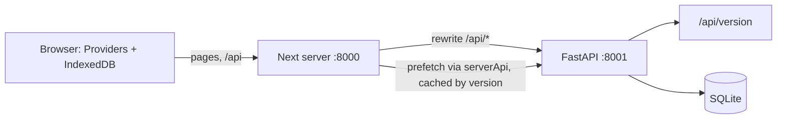
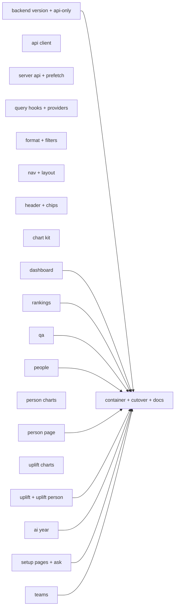

# React + Astryx frontend on Next.js (SSR): build plan

**Review plan:** docs/plans/2026-11-25-react-astryx-frontend.review.md
**Goal:** Replace `delivery_analysis/app/static/` with a Next.js (SSR) + React 19 + Astryx app in `web/`, caching API results by data version in the browser (IndexedDB) and on the Next server.
**Architecture:** One container. Next server on `$PORT` (8000) serves pages and rewrites `/api/*` to FastAPI on `127.0.0.1:8001`. FastAPI is API-only and exposes `GET /api/version`.
**Tech stack:** Python 3.13 / FastAPI (tests: `uv run pytest -q`); Node 22.13+, Next 16.4.6 App Router, React 19.3.1, `@astryxdesign/core` + `@astryxdesign/theme-neutral` + `@astryxdesign/cli` 0.7.17, `@stylexjs/stylex` 0.19.2, `@tanstack/react-query` + `-persist-client` + `query-async-storage-persister` 5.108.4, `idb-keyval` 6.3.0, `recharts` 3.11.1; tests `cd web && npx vitest run` (vitest 5.1.2, jsdom, @testing-library/react 16.3.3, @testing-library/jest-dom).
**Spec:** docs/plans/2026-11-25-react-astryx-frontend.spec.md
**Detail:** tests
**Full suite:** yes
**Target-min:** 25
**Ignore:** web/node_modules/, web/.next/, web/next-env.d.ts, .venv/, *.sqlite, .claude/, docs/plans/*.spec.md, docs/plans/*.review.md

## Global constraints
- Exact versions above, pinned (no `^`). Import Astryx per entry (`@astryxdesign/core/Button`); global CSS imports `@astryxdesign/core/reset.css` then `astryx.css`; app wrapped in `<Theme>` from the generated `web/astryx-themes`. Read `web/AGENTS.md` (written by `astryx init`) before writing UI.
- TS strict; path alias `@/*` → `web/*`. Client components start with `"use client"`.
- Port behaviour from the old files in `delivery_analysis/app/static/` (same labels, URL params `team window from to metric inactive id`, API paths, CSV links). Old files stay until T20.
- Every API read in the browser goes through `useApi`; every write through `useWrite`. No direct `fetch` in components.
- Charts: Recharts, colours from Astryx `dataVars` categorical tokens.
- Page = `web/app/<route>/page.tsx` (server: `await prefetch([...paths])`, wraps the client view in `<HydrationBoundary>`) + `web/components/pages/<Name>.tsx` (client view) + its `.test.tsx` that mocks `@/lib/query` (`useApi` returns fixture data by path).
- Containers: use `podman` (5.7, installed) for every build/run, never `docker`; docs and comments show `podman build` / `podman run`.
- Data version moves on sync finish, refresh finish, and any successful POST/PUT/PATCH/DELETE except `/api/refresh`.

## Main diagram


## File structure
- `delivery_analysis/app/version.py`: data version + router. `app/context.py`: write counter. `app/server.py`: API-only, origin port. `cli/main.py`: `serve --origin-port`.
- `web/lib/api.ts` fetch + errors · `web/lib/server-api.ts` server fetch cache + prefetch · `web/lib/query.ts` useApi/useWrite/useDataVersion · `web/components/Providers.tsx` QueryClient + persister · `web/lib/format.ts` · `web/lib/filters.ts`
- `web/components/Nav.tsx`, `Header.tsx` (pickers, chips, refresh) · `web/components/charts/*` · `web/components/pages/*` · `web/app/**/page.tsx`
- `scripts/start.sh` (both processes), `scripts/dev.sh`, `Dockerfile`, `tests/test_start_script.py`.

## Task graph

Ruling: sequential [T20] - T20 deletes the old static files every page task reads and its smoke test hits every route - cost if wrong: a few minutes of waiting.

## Backend

### T1 data version + API-only server · Complexity 5 · Est. context 40k
**Owns:** delivery_analysis/app/version.py, delivery_analysis/app/context.py, delivery_analysis/app/server.py, delivery_analysis/cli/main.py, tests/test_app_version.py, tests/test_app_server.py
**Components:** 2
**LOC owned:** 150
**Tests:** fast
**Model:** sonnet
**Produces:** delivery_analysis.app.version.data_version(ctx: AppContext) -> str
  e.g. data_version(ctx) on a fresh DB -> "a1b2c3d4e5f6" (12 hex chars, same value on repeat calls)
**Notes:** AppContext gains `started_at: str` (ISO, set at creation) and `write_count: int = 0`; the server middleware bumps it after a write response with status < 400 whose path is not `/api/refresh`. Version = sha1 of sorted `connector/scope=last_run:status` + `refresh=<worker finished_at>` + `writes=<started_at>:<write_count>`, first 12 hex. `GET /api/version` → `{"version": ...}`. Remove `PAGES`, the page routes and the `/static` mount. `create_app(..., origin_port=None)`: origin checks use `origin_port or port`. `serve --origin-port N` passes it. Update tests/test_app_server.py: drop page tests, add the ones below.
**Test code:**
```python
def test_version_changes_after_a_write_but_not_after_a_read(client):
    v1 = client.get("/api/version").json()["version"]
    assert client.get("/api/teams").status_code == 200
    assert client.get("/api/version").json()["version"] == v1
    client.post("/api/teams", json={"name": "Core", "team_id": "core"}, headers={"origin": "http://127.0.0.1"})
    assert client.get("/api/version").json()["version"] != v1

def test_refresh_post_does_not_bump_the_write_counter(client):
    v1 = client.get("/api/version").json()["version"]
    client.post("/api/refresh", json={"only_stale": True}, headers={"origin": "http://127.0.0.1"})
    assert client.app.state.context.write_count == 0

def test_writes_relayed_from_the_front_port_pass_the_origin_check(tmp_path):
    app = create_app(tmp_path / "d.sqlite", port=8001, origin_port=8000)
    c = TestClient(app, base_url="http://127.0.0.1:8001")
    assert c.post("/api/teams", json={"name": "A", "team_id": "a"}, headers={"origin": "http://127.0.0.1:8000"}).status_code < 400
    assert c.post("/api/teams", json={"name": "B", "team_id": "b"}, headers={"origin": "http://127.0.0.1:8001"}).status_code == 403

def test_pages_are_no_longer_served(client):
    assert client.get("/").status_code == 404
```
**Review Focus:** protocol: `test_cross_site_write_still_403` (sec-fetch-site cross-site → 403); state: version stable across 3 reads.

## Web core

### T2 API client · Complexity 2 · Est. context 22k
**Owns:** web/lib/api.ts, web/lib/api.test.ts
**Components:** 1
**LOC owned:** 70
**Tests:** fast
**Kind:** mechanical
**Model:** haiku
**Produces:** lib.api.api(path: string, init?: { method?: string; body?: unknown }) -> Promise<unknown>
  e.g. api("/api/version") -> { version: "a1b2c3d4e5f6" }
  e.g. api("/api/teams/x") on 404 {detail: "No team"} -> throws ApiError("No team", 404)
**Notes:** port `DA.api`: JSON body sets Content-Type; non-JSON body → `{}`; `detail` array → messages joined by "; "; no detail → "HTTP <status>". `ApiError extends Error { status: number }`.
**Test code:** `api.test.ts` with `vi.stubGlobal("fetch", ...)`: `returns_json`, `posts_json_body_with_content_type`, `detail_string_becomes_message` ("No team", 404), `detail_array_joined` ([{msg:"a"},{msg:"b"}] → "a; b"), `no_detail_uses_status` (500 → "HTTP 500").

### T3 server API + prefetch · Complexity 4 · Est. context 30k
**Owns:** web/lib/server-api.ts, web/lib/server-api.test.ts
**Components:** 1
**LOC owned:** 110
**Tests:** fast
**Model:** sonnet
**Produces:** lib.server-api.serverApi(path: string) -> Promise<unknown>
**Produces:** lib.server-api.prefetch(paths: string[]) -> Promise<DehydratedState>
  e.g. prefetch(["/api/teams"]) -> dehydrated state with one query, key ["a1b2c3d4e5f6", "/api/teams"]
**Notes:** origin `process.env.API_ORIGIN ?? "http://127.0.0.1:8001"`. Version fetched at most every 5 s (module cache). Results cached in a Map keyed `version + path`, max 500 entries (drop oldest); a new version clears it. Query key shape `[version, path]` is the contract with T4.
**Test code:** `server_api_reuses_result_for_same_version` (2 calls → 1 fetch of the path), `new_version_refetches`, `prefetch_keys_are_version_then_path`, `cache_caps_at_500`.

### T4 query hooks + providers · Complexity 5 · Est. context 36k
**Owns:** web/lib/query.ts, web/components/Providers.tsx, web/lib/query.test.tsx
**Components:** 2
**LOC owned:** 140
**Tests:** fast
**Model:** sonnet
**Produces:** lib.query.useApi(path: string | null) -> UseQueryResult<unknown>
**Produces:** lib.query.useWrite() -> (path: string, method: string, body?: unknown) -> Promise<unknown>
**Produces:** lib.query.useDataVersion() -> string
**Produces:** lib.query.recheckVersion() -> Promise<void>
  e.g. useApi("/api/teams") -> { data: { teams: [...] }, isPending: false }; useApi(null) -> disabled, no fetch
**Notes:** key `[version, path]`, `staleTime: Infinity`, `gcTime: 7 days`. Version itself is a query `["__version"]` refetched on mount, window focus and every 60 s; when it changes, `removeQueries` for every key whose first element is not the new version. `useWrite` calls `api`, then `recheckVersion()`. `Providers` = `PersistQueryClientProvider` with an `idb-keyval` async persister (`buster` = app build id, `maxAge` 7 days); initial version comes from a `version` prop set by the layout.
**Test code:** `same_version_second_mount_no_fetch`, `version_change_drops_old_queries_and_refetches`, `null_path_does_not_fetch`, `write_rechecks_version`.

### T5 format + filters · Complexity 2 · Est. context 24k
**Owns:** web/lib/format.ts, web/lib/filters.ts, web/lib/format.test.ts, web/lib/filters.test.ts
**Components:** 2
**LOC owned:** 130
**Tests:** fast
**Kind:** mechanical
**Model:** haiku
**Produces:** lib.format.fmt(value: number | null | undefined, unit?: string) -> string
  e.g. fmt(0.42, "ratio") -> "42%"; fmt(50, "hours") -> "2.1 d"; fmt(null) -> "–"; fmt(3) -> "3"
**Produces:** lib.format.trendInfo(trend: number | null, better?: string) -> { text: string; kind: "" | "good" | "bad" }
  e.g. trendInfo(0.12, "higher") -> { text: "▲ +12%", kind: "good" }; trendInfo(-0.05, "lower") -> { text: "▼ -5%", kind: "good" }
**Produces:** lib.format.ago(iso: string | null, now?: number) -> string
**Produces:** lib.filters.useFilters() -> Filters
**Produces:** lib.filters.filterQuery(f: Filters, extra?: Record<string, string | undefined>) -> string
  e.g. filterQuery({team: "core", window: "custom", from: "2026-10-01", to: "2026-10-31"}) -> "?team=core&window=custom&from=2026-10-01&to=2026-10-31"; filterQuery({}) -> ""
**Produces:** lib.filters.useSetParam() -> (name: string, value: string) -> void
**Produces:** lib.filters.windowOptions(now: Date) -> [string, string][]
**Notes:** exact ports of `DA.fmt`, `DA.trend` (text/kind only), `DA.ago`, `DA.state`, `DA.query`, `DA.setParam` (router.replace, no scroll), `windowOptions` from app.js. `Filters = {team, window, from, to, metric, inactive, id}` strings, "" when absent.
**Test code:** every `e.g.` above as an assertion, plus `ago(null) -> "never"`, `ago` 30 min → "30 min ago", 3 h → "3 h ago", 3 d → "3 d ago"; `windowOptions(new Date(2026,10,25))` has 10 entries, `[2]` is `["month:2026-11","November 2026"]`, last is `["custom","Custom dates"]`.

## Shell

### T6 nav + layout · Complexity 3 · Est. context 28k
**Owns:** web/app/layout.tsx, web/components/Nav.tsx, web/components/Nav.test.tsx
**Components:** 2
**LOC owned:** 110
**Tests:** fast
**Model:** sonnet
**Produces:** components.Nav.Nav() -> JSX.Element
**Notes:** Astryx AppShell side nav, same order and groups as the old nav (Dashboard, People, AI uplift, AI year, Rankings, QA, Ask; "Set up": Selection, Teams, Sources, Settings). Links carry `filterQuery(useFilters())`; active link = current path, and People is active on `/people` too. Layout: server component, fetches version via `serverApi("/api/version")`, renders `<Providers version>`, `<Theme>`, `<Nav/>`, `<Header/>`, children.
**Test code:** `links_keep_team_and_window` (team=core → every href ends `?team=core`), `people_active_on_people_path`, `eleven_links_in_order`.

### T7 header + freshness chips · Complexity 5 · Est. context 34k
**Owns:** web/components/Header.tsx, web/components/Header.test.tsx
**Components:** 2
**LOC owned:** 170
**Tests:** fast
**Model:** sonnet
**Produces:** components.Header.Header() -> JSX.Element
**Notes:** ports `buildHeader`, `DA.showSources`, `DA.refresh`: team select (All repositories + `/api/teams`), window select from `windowOptions`, custom dates shown only for `custom`, Refresh button. Chips from `/api/sources` (fresh/stale/failed per connector, waiting ones "x not connected", "refreshing" while running, re-polled every 3 s). When a running refresh finishes, `recheckVersion()`. On first mount POST `/api/refresh {only_stale:true}` once. Refresh failure shows an Astryx Toast "Refresh failed: <msg>".
**Test code:** `custom_dates_only_for_custom_window`, `chip_kinds_from_sources` (age ≥ refresh_after → stale), `finished_refresh_rechecks_version`, `auto_refresh_posts_only_stale_once`.

### T8 chart kit · Complexity 4 · Est. context 32k
**Owns:** web/components/charts/Charts.tsx, web/components/charts/Charts.test.tsx
**Components:** 1
**LOC owned:** 150
**Tests:** fast
**Model:** sonnet
**Produces:** components.charts.Charts.LineChart(props: { series: {label: string; points: {x: string; y: number | null}[]}[]; unit?: string }) -> JSX.Element
**Produces:** components.charts.Charts.BarChart(props: { bars: {label: string; value: number}[]; unit?: string }) -> JSX.Element
**Notes:** port charts.js shapes; y-axis and tooltips use `fmt(value, unit)`; null points are gaps; colours cycle Astryx categorical data tokens. `ResponsiveContainer` with fixed height 260.
**Test code:** `line_chart_renders_one_path_per_series`, `bar_chart_labels`, `tooltip_uses_fmt_unit`.

## Pages
Each: `**Probe entry:** serve=web` · Review Focus: encoding (names with `<script>` render as text), protocol (same API paths and query strings as the old page).

### T9 Dashboard · Complexity 4 · Est. context 36k
**Owns:** web/app/page.tsx, web/components/pages/Dashboard.tsx, web/components/pages/Dashboard.test.tsx
**Components:** 1 · **LOC owned:** 180 · **Tests:** fast · **Model:** sonnet
**Notes:** port dashboard.js (cards, trends, notes, metric drill-down via `metric` param).
**Test code:** `renders_metric_cards_with_fmt`, `metric_param_opens_detail`, `script_in_name_is_text`.

### T10 Rankings · Complexity 3 · Est. context 26k
**Owns:** web/app/rankings/page.tsx, web/components/pages/Rankings.tsx, web/components/pages/Rankings.test.tsx
**Components:** 1 · **LOC owned:** 90 · **Tests:** fast · **Model:** sonnet
**Test code:** `ranks_by_selected_metric`, `metric_select_sets_param`.

### T11 QA · Complexity 3 · Est. context 28k
**Owns:** web/app/qa/page.tsx, web/components/pages/Qa.tsx, web/components/pages/Qa.test.tsx
**Components:** 1 · **LOC owned:** 120 · **Tests:** fast · **Model:** sonnet
**Notes:** port qa.js; CSV link `/api/qa/export.csv` + filterQuery; keep the print-to-PDF styles (`@media print`).
**Test code:** `shows_fail_rate_by_sprint`, `csv_link_keeps_filters`.

### T12 People matrix · Complexity 3 · Est. context 28k
**Owns:** web/app/people/page.tsx, web/components/pages/People.tsx, web/components/pages/People.test.tsx
**Components:** 1 · **LOC owned:** 120 · **Tests:** fast · **Model:** sonnet
**Test code:** `matrix_rows_link_to_person`, `inactive_toggle_sets_param`.

### T13 person charts · Complexity 5 · Est. context 40k
**Owns:** web/components/charts/PersonCharts.tsx, web/components/charts/PersonCharts.test.tsx
**Components:** 1 · **LOC owned:** 220 · **Tests:** fast · **Model:** sonnet
**Produces:** components.charts.PersonCharts.PersonCharts(props: { personId: string; filters: Filters }) -> JSX.Element
**Notes:** port person-charts.js (series, weekly points, comparison panel). Keep the stash@{0} edit: with no team, the panel is visible, summary "Who counts as the team? Pick a team in the Team box at the top first", people list empty, group note "Without a team the dashed line is the median of everyone."
**Test code:** `no_team_shows_pick_a_team_prompt`, `team_comparison_draws_dashed_median`, `weekly_points_bars`.

### T14 Person page · Complexity 4 · Est. context 34k
**Owns:** web/app/person/page.tsx, web/components/pages/Person.tsx, web/components/pages/Person.test.tsx
**Components:** 1 · **LOC owned:** 140 · **Tests:** fast · **Model:** sonnet
**Notes:** renders `<PersonCharts personId filters/>` from `@/components/charts/PersonCharts` (T13; mock it in tests). Port person.js (picker, metrics, tickets, CSV `/api/people/{id}/export.csv`). Keep the stash@{0} edit: with no team and exactly one team in `/api/teams`, set `team` to it.
**Test code:** `single_team_is_auto_selected`, `tickets_table_rows`, `csv_link_for_person`.

### T15 uplift charts · Complexity 4 · Est. context 32k
**Owns:** web/components/charts/UpliftCharts.tsx, web/components/charts/UpliftCharts.test.tsx
**Components:** 1 · **LOC owned:** 160 · **Tests:** fast · **Model:** sonnet
**Produces:** components.charts.UpliftCharts.UpliftChart(props: { cohort: unknown; compare: string }) -> JSX.Element
**Notes:** port uplift-charts.js (before/after Claude-era series against the comparison group).
**Test code:** `before_after_split_at_cutover`, `comparison_series_dashed`.

### T16 AI uplift + uplift person · Complexity 5 · Est. context 40k
**Owns:** web/app/uplift/page.tsx, web/app/uplift/person/page.tsx, web/components/pages/Uplift.tsx, web/components/pages/UpliftPerson.tsx, web/components/pages/Uplift.test.tsx
**Components:** 2 · **LOC owned:** 220 · **Tests:** fast · **Model:** sonnet
**Notes:** renders `<UpliftChart cohort compare/>` from `@/components/charts/UpliftCharts` (T15; mock it in tests). Port uplift.js and uplift-person.js.
**Test code:** `cohort_table_and_compare_select`, `uplift_person_reads_id_param`.

### T17 AI year · Complexity 4 · Est. context 32k
**Owns:** web/app/ai-year/page.tsx, web/components/pages/AiYear.tsx, web/components/pages/AiYear.test.tsx
**Components:** 1 · **LOC owned:** 150 · **Tests:** fast · **Model:** sonnet
**Test code:** `year_people_rows`, `person_detail_on_id_param`.

### T18 setup pages + Ask · Complexity 4 · Est. context 36k
**Owns:** web/app/selection/page.tsx, web/app/sources/page.tsx, web/app/settings/page.tsx, web/app/ask/page.tsx, web/components/pages/Setup.tsx, web/components/pages/Setup.test.tsx
**Components:** 2 · **LOC owned:** 200 · **Tests:** fast · **Model:** sonnet
**Notes:** port selection.js (add/remove repos via `useWrite`), sources.js, settings.js; Ask = same empty placeholder.
**Test code:** `add_repo_posts_and_rechecks`, `remove_repo_deletes`, `settings_values_shown`.

### T19 Teams · Complexity 4 · Est. context 34k
**Owns:** web/app/teams/page.tsx, web/components/pages/Teams.tsx, web/components/pages/Teams.test.tsx
**Components:** 1 · **LOC owned:** 150 · **Tests:** fast · **Model:** sonnet
**Notes:** port teams.js: create team, members, unmapped identities, comparison PUT.
**Test code:** `create_team_posts`, `map_identity_posts`, `comparison_put`.

## Ship

### T20 container + cutover + docs · Complexity 5 · Est. context 40k
**Owns:** Dockerfile, scripts/start.sh, scripts/dev.sh, tests/test_start_script.py, README.md, AGENTS.md, delivery_analysis/app/static/, tests/test_static_assets.py, tests/test_static_uplift_charts.py, tests/test_static_uplift_pages.py
**Components:** 2 · **LOC owned:** 160 · **Tests:** slow · **Model:** sonnet
**Notes:** Dockerfile: `node:22-slim` build stage (`npm ci && npm run build`, Next `output: "standalone"`), runtime copies the Node binary + standalone output into the python image. `start.sh`: FastAPI `serve --no-browser --port 8001 --origin-port $PORT` with `BIND_HOST=127.0.0.1`, then `node web/server.js` on `$PORT`; exits non-zero when either exits. Delete the old static dir and its three test files. Dockerfile header comments and README use `podman build -t delivery-analytics .` / `podman run -p 8000:8000 ...`. Verify with `podman build` once. README: dev (`scripts/dev.sh`), build, hosting; AGENTS: frontend layout.
**Test code:** `test_start_script_serves_pages_and_api` (slow; skips if `web/.next/standalone` missing): start.sh on a temp DB and free port, GET each of the 13 routes → 200 HTML, `/api/version` → JSON, kill one child → script exits non-zero.

### T21 page-serving test cleanup · Complexity 1 · Est. context 20k
**Owns:** tests/test_app_api.py, tests/test_app_api_uplift.py, tests/test_sprints.py, tests/test_ai_year.py
**Components:** 1
**LOC owned:** 30
**Tests:** fast
**Model:** sonnet
**Notes:** follow-up to T1 (FastAPI no longer serves HTML): delete only the tests that GET an HTML page; keep every API test. Built by T1's agent.
**Test code:** `uv run pytest -q tests/test_app_api.py tests/test_app_api_uplift.py tests/test_sprints.py` passes.

### T22 build fixes follow-up · Complexity 2 · Est. context 24k
**Owns:** web/lib/filter-query.ts, web/lib/filter-query.test.ts, .dockerignore, tests/test_nav_uplift.py
**Components:** 1
**LOC owned:** 60
**Tests:** fast
**Model:** sonnet
**Notes:** follow-up from T20: pure `Filters`/`filterQuery`/`windowOptions` move to `filter-query.ts` (server-safe; `filters.ts` re-exports them and keeps the hooks under `"use client"`); `.dockerignore` keeps `scripts/start.sh` and drops `web/node_modules`, `web/.next`; delete the `test_nav_link` cases that read deleted static HTML.
**Test code:** `cd web && npm run build` succeeds; `filterQuery({team:"core"})` from filter-query.ts -> "?team=core".

## Review Focus
- Backend (HTTP service): protocol, state. Risks: relayed writes vs origin check, version counter on refresh.
- Web core (library): state. Risks: cache not cleared on version change, persister restoring an old version, SSR key mismatch with client key.
- Pages (web UI): protocol via API, encoding.
**Probe entry:** call=delivery_analysis.app.version.data_version · serve=delivery_analysis.app.server.create_app

## Self-review
All 13 routes owned (T9-T19); stash edits in T13/T14; version rules in T1; cache contract `[version, path]` shared by T3/T4; no file owned twice.
