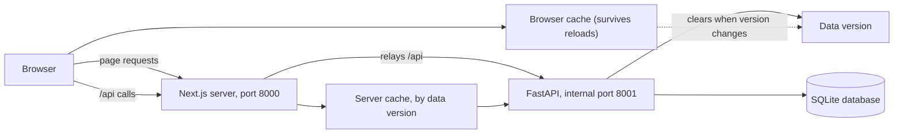
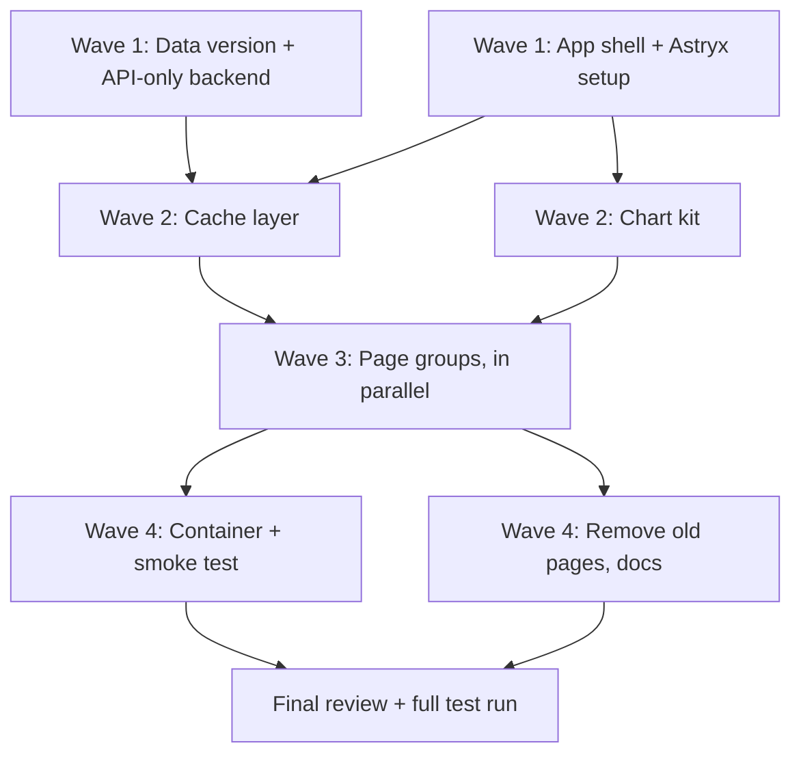

# React + Astryx frontend on Next.js: review plan

**Spec:** docs/plans/2026-11-25-react-astryx-frontend.spec.md

## Summary
Replace the 13 hand-built HTML/JS pages with a React app built on Meta's Astryx design system, server-rendered by Next.js. Next.js runs as a Node service in the same container as the existing Python API and sits in front of it. Results are cached in the browser and on the Next server, keyed by a "data version" that changes only when a sync finishes or settings are edited, so pages stop refetching the same numbers on every visit.

## What you will get
- Every current page (Dashboard, People, Person, AI uplift, AI uplift person, AI year, Rankings, QA, Ask, Selection, Teams, Sources, Settings) rebuilt in Astryx with the same data, filters, links and actions.
- Pages arrive already filled in (server-rendered), not as a blank shell that then loads.
- Going back to a page you've seen, or reloading the browser, shows cached results instantly with no API call, until the next sync finishes.
- Charts redrawn with Recharts in Astryx colours.
- One Docker image that still runs on App Service on port 8000 with the same settings.
- The two unreleased tweaks from the hosting branch kept: Person auto-picks the only team, and the comparison panel explains what to do when no team is picked.
- The old static pages and their tests removed.

## What will be built
| Part | What it does (one sentence) | Size | Built by |
|---|---|---|---|
| Data version | A small API call that returns a value that changes whenever a sync finishes or settings are edited | S | a careful helper |
| API-only backend | FastAPI stops serving pages, runs on an internal port, and still accepts calls relayed by Next | S | a careful helper |
| App shell | Next.js + Astryx setup, navigation, team/window pickers in the URL, freshness chips and the Refresh button | M | a careful helper |
| Cache layer | The fetch helper, the browser cache (kept across reloads), the server-side cache and the version watcher that clears both | M | a careful helper |
| Chart kit | Recharts versions of the current line, bar and person/uplift charts | M | a careful helper |
| Dashboard + Rankings | Team metrics cards, trends and rankings tables | M | a careful helper |
| People + Person | The people matrix, person detail, tickets, weekly points and CSV export link | M | a careful helper |
| AI uplift pages | AI uplift, AI uplift person and AI year screens | L (split in two) | a careful helper |
| QA | QA fail rate, escape defects, regressions, with CSV export | S | a fast helper |
| Setup pages + Ask | Selection, Teams, Sources, Settings (the write screens) and the Ask placeholder | M | a careful helper |
| Container | A two-stage Docker build, a start script that runs both services, and a smoke test of every route | M | a careful helper |
| Docs | README and AGENTS updates for running, developing and hosting | S | a fast helper |

## How it fits together


## Key code changes
The data version is a fingerprint of each source's last sync, the refresh worker's last finish, and a counter that any successful write (teams, repos, identities, comparison) bumps, so it moves whenever the numbers can have changed:

```python
@router.get("/version")
def version() -> Dict[str, str]:
    with _db(ctx) as conn:
        marks = sorted(f"{s['connector']}/{s['scope']}={s['last_run']}:{s['status']}" for s in list_sync_states(conn))
    marks += [f"refresh={ctx.worker.state()['finished_at']}", f"writes={ctx.started_at}:{ctx.write_count}"]
    return {"version": hashlib.sha1("|".join(marks).encode()).hexdigest()[:12]}
```

Every query carries the version in its key and never goes stale on its own; a new version clears the cache:

```ts
export function useApi<T>(path: string) {
  const version = useDataVersion();          // polled cheaply; also bumped when a refresh finishes
  return useQuery<T>({
    queryKey: [version, path],
    queryFn: () => api<T>(path),
    staleTime: Infinity,                      // same version, same answer: never refetch
  });
}
// QueryClient is persisted to IndexedDB, so reloads reuse it too.
```

Server rendering fetches through the same keys and hands the results to the browser, so the first paint is filled in and the browser cache starts warm:

```tsx
export default async function DashboardPage({ searchParams }) {
  const qc = new QueryClient();
  const version = await serverVersion();                 // cached on the Next server for a few seconds
  await qc.prefetchQuery({ queryKey: [version, metricsPath(searchParams)], queryFn: serverFetch });
  return <HydrationBoundary state={dehydrate(qc)}><Dashboard /></HydrationBoundary>;
}
```

## How it gets built


## Decisions you can change
- Where the frontend lives: `web/` folder in this repo (default) | a separate repo
- Browser cache storage: IndexedDB (default) | localStorage (smaller limit, simpler)
- How the browser learns the version changed: check on each page view and every 60 s, and right after a refresh finishes (default) | only after a refresh you started
- Frontend tests: unit tests with Vitest (default) | add Playwright end-to-end tests (slower, more setup)
- Ask page: ported as the same empty placeholder (default) | dropped from the nav
- Full test suite: run once at finish (you chose this)

## Risks
- Astryx is beta (0.7.x) and changes between minors: pin exact versions and upgrade with its CLI.
- FastAPI's host and origin checks could reject calls relayed by Next: Next keeps the browser's Host and Origin headers, and the backend tests cover a relayed write.
- Two processes in one container: if either dies the start script stops the container, so App Service restarts it.
- Cached numbers shown after a sync: the version check on each page view clears the cache; the freshness chips still show sync age.
- Node isn't installed in WSL here: builds and tests run with Node 22 (the Docker build stage, or a local Node install). I'll check before building.
- Port parity: each page is checked against the old page on the same seeded database before the old pages are deleted.

## Out of scope
- New metrics or API changes beyond the data version.
- Login inside the app, offline mode, mobile-specific layouts.
- Keeping the old UI alive after the switch.

## How we will know it works
- `docker run` the image and open every page on port 8000; each shows the same numbers as today's UI for the same team and window.
- Dashboard → People → Dashboard: the second Dashboard visit makes no metrics request in the network tab.
- Reload the browser: results show with no API calls; run Refresh, and when it finishes the page refetches.
- Add a repo and change a team comparison from the browser; a request from another site still gets 403.
- Python and frontend test suites pass, and the container smoke test passes.

## Rough time and cost
About 1.5 to 3 hours and $50 to $120 (rough, until the build plan is linted).
