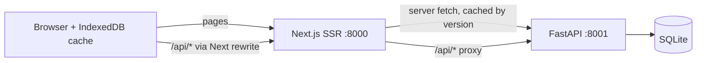

# Spec: React + Astryx frontend on Next.js (SSR), with cached results

## Intent

The current UI is 13 hand-built HTML pages with vanilla JS that refetch every API result on every page load. Rewrite it as a React app on Astryx (Meta's design system) served by Next.js with server rendering, and keep API results cached in the browser until the data actually changes (a sync finishes), so moving between pages is instant.

## Goals

- All 13 pages ported with the same data, filters, URL parameters and actions: Dashboard, People, Person, AI uplift, AI uplift person, AI year, Rankings, QA, Ask, Selection, Teams, Sources, Settings.
- Server-rendered first paint: every page's first response contains its data, not a spinner.
- Browser cache: a result already fetched for the current data version is reused across navigations and reloads with no network request for it.
- One data version from the backend that changes on sync or any write; when it changes, cached results are discarded and refetched.
- One container on Azure App Service: Next.js on the public port, FastAPI on an internal port.

## Non-goals

- New metrics, pages or API fields beyond the data-version endpoint.
- Login or auth inside the app (App Service Authentication stays in front).
- Offline mode, service worker, PWA.
- Keeping the old static UI alive after cutover.

## Constraints

- Node 22.13+ at build and run time; React 19; Next.js App Router; `@astryxdesign/core` + `@astryxdesign/theme-neutral` pinned to exact versions (beta, 0.7.x).
- Charts with Recharts, coloured with Astryx data tokens.
- FastAPI keeps its host and origin checks; the Next proxy must pass them, not weaken them.
- The `/api/*` contract is unchanged (CSV exports included); writes still go browser → `/api/*`.
- Keep the two unreleased UX edits from `hosting/docker-app-service` (stash@{0}): on Person, auto-pick the only team; on the comparison panel with no team, show the "pick a team" prompt and the "median of everyone" note.

## Done looks like

- `docker run` of the image serves every page on port 8000 behind the same `PUBLIC_HOSTS` / `WEBSITES_PORT` settings as today.
- Each page shows the same numbers as the old page for the same team and window (checked against a seeded test database).
- Navigating Dashboard → People → Dashboard makes no second request for the Dashboard's metrics (visible in the network tab).
- Reloading the browser after a visit serves cached results without a request, until a refresh finishes; then the next view refetches.
- Writes (add repo, teams, identities, comparison, refresh) work through the browser and still get 403 for cross-site requests.
- Python tests pass (static-page tests removed or replaced); frontend unit tests pass; a container smoke test hits every route.

## Decided

- Layout: the frontend lives in `web/` at the repo root; FastAPI serves only `/api/*` and `/healthz`-style routes, no HTML.
- Topology: one container; Next server on `$PORT` (8000); FastAPI on `127.0.0.1:8001`; Next rewrites `/api/*` to FastAPI.
- Data version: `GET /api/version` → `{"version": "<opaque string>"}`, derived from each source's last sync time and status, the refresh worker's last finish, and a counter bumped by every successful write (process start time + count). The browser that made a write also clears its cache at once.
- Client cache: TanStack Query, persisted to IndexedDB, query keys include the data version, `staleTime: Infinity` within a version.
- Server cache: the Next server keeps rendered-data fetches keyed by (path, data version), so SSR does not re-hit FastAPI for unchanged data.
- Cutover: one release; delete `delivery_analysis/app/static/` and its tests.

## Left to the builder / plan

- Component split, file layout inside `web/`, process supervisor choice in the container, chart component structure, test helpers.

## Diagrams

